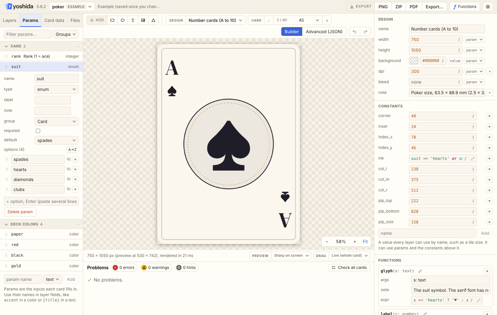
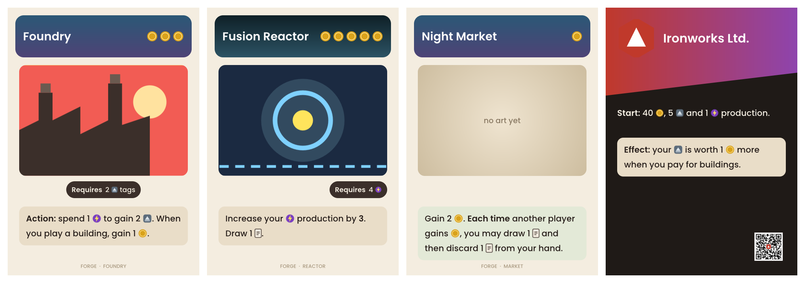
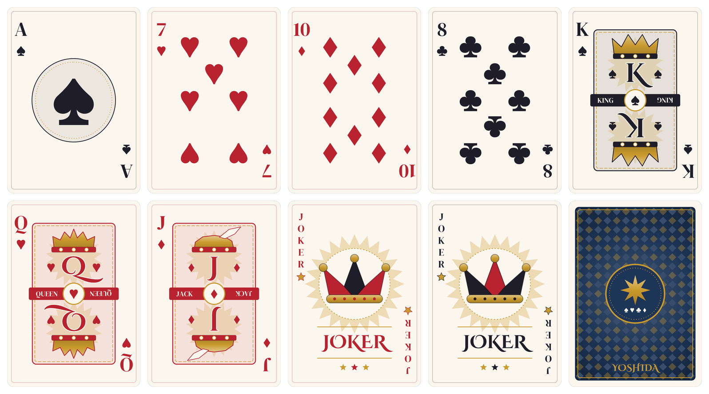
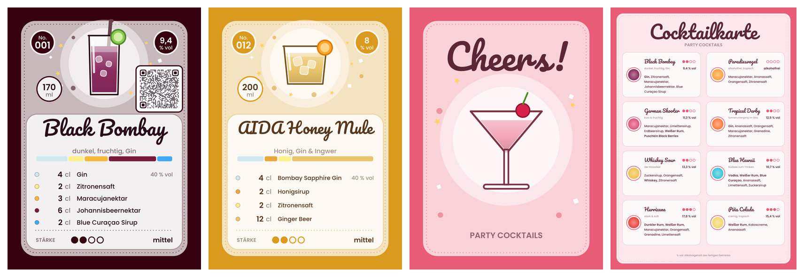

<p align="center">
  
</p>
<p align="center">
  <strong>One design. Every card.</strong><br>
  Design a card once, fill it from a table, export every card. Your cards, your data.
</p>
<p align="center">
  <a href="https://yoshida.xoyz.dev/editor/"><b>Open the editor</b></a> ·
  <a href="https://yoshida.xoyz.dev/docs/getting-started/">Getting started</a> ·
  <a href="https://yoshida.xoyz.dev/docs/">Docs</a> ·
  <a href="https://yoshida.xoyz.dev/docs/examples/">Examples</a> ·
  <a href="https://github.com/XOYZ69/yoshida/releases/latest">Download</a> ·
  <a href="https://yoshida.xoyz.dev/dev/">Dev preview</a>
</p>

yoshida is the card creator I always wanted. Way too complicated, way too many possibilities... and now with a functional browser version.
Design your cards and just apply the data, press export and happy playing, printing, whatever you wanna do.

Designs are simple JSON files that are easy to share, modify and abuse as much as you want. The editor runs in your browser and your cards stay there; there is also a **desktop app (beta)** for Windows and Linux. (Rendering on a server is an **optional** switch for self-hosted setups; only then does your data leave your machine.)

<!-- The same screenshot as the docs, retaken with `npm run docs:screenshots` in web/. -->
<p align="center">
  <picture>
    <source media="(prefers-color-scheme: dark)" srcset="site/static/docs/images/editor-params-dark.png">
    
  </picture>
</p>

## Try it

| | |
| --- | --- |
| **In the browser** | Open <https://yoshida.xoyz.dev/editor/>, nothing to install. Pick an example from the project menu, change it, export. |
| **On your computer** | Download the [latest release](https://github.com/XOYZ69/yoshida/releases/latest) zip (Linux, macOS, Windows), unzip it and run `./start.sh`, `start.command` or `start.bat`. Then open <http://localhost:8080/editor/>. |
| **Desktop app (beta)** | Download the installer from the [latest release](https://github.com/XOYZ69/yoshida/releases/latest): `yoshida-beta_<version>_x64-setup.exe` for Windows, `.AppImage`, `.deb` or `.rpm` for Linux. It links projects to real folders on disk and renders with its own built-in renderer. On Arch Linux build the package from a checkout: [`desktop/packaging/arch`](desktop/packaging/arch). More in [Desktop App](https://yoshida.xoyz.dev/docs/desktop-app/). |
| **With Docker** | `docker compose up --build`, then open <http://localhost:8080/editor/>. |
| **From the command line** | `yoshida check examples/forge` and `yoshida render examples/forge --out out` (the `yoshida` program is in the release zip). |

New here? [Getting Started](https://yoshida.xoyz.dev/docs/getting-started/) takes you to a first card in five minutes.

> **Dev preview:** the `dev` branch, with what the next release will bring, is live at <https://yoshida.xoyz.dev/dev/> (editor: <https://yoshida.xoyz.dev/dev/editor/>). It carries a red **DEV** stamp and is not as well tested as a release.

## What it can do

<p align="center">
  
</p>

- A **visual editor** in the browser: drag, resize and rotate layers, preview every card live
- **Layers** for shapes, text, images, QR codes and groups (if something is missing, open an issue)
- **Formulas** in almost every field: positions, colours and text that react to the card's data
- **Card text with icons**: `<b>Action:</b> spend 1 {icon:energy}` just works, and text wraps, shrinks to fit and truncates
- **Rows and columns** that measure their content, for cost coins, pills and chips
- **Gradients**, **SVG** art, rounded and clipped images, optional images with a placeholder
- **Components**: share layers between designs with `include`
- **Card data** from JSON or a CSV spreadsheet, one row per card
- **Print ready**: PNG with dpi, one PDF per set with bleed and crop marks, SVG, or a deck sheet for tabletop simulators (`--sheet 10x7`)
- **Clear error messages** with file, line and a hint. Probably the best feature
- The same pixels in the **editor**, on the **command line** and on a **server**

The [Feature Tour](https://yoshida.xoyz.dev/docs/feature-tour/) has a snippet for each of these.

## Examples

Working projects are in [`examples/`](examples), and in the editor's project menu:

| Example | What it shows |
| --- | --- |
| [`forge`](examples/forge) | A small engine-builder card game: icons in text, rows, gradients, SVG art, a shared component, a QR code. The one to copy for a new project |
| [`poker`](examples/poker) | A full deck of 52 cards, jokers and a back from four designs |
| [`cocktails`](examples/cocktails) | Recipe cards, a menu and a shopping list at 600 dpi from one ingredient list |
| [`board-game`](examples/board-game) | A printable A3 party board built from one list |

<p align="center">
  
  
</p>

## Project files

The editor exports a whole project (designs, card files, images and fonts) as a single `.yoshida` file. It is a zip container, like `.docx`, so you can share it, open it again with **Open project file…** or by dropping it on the editor, and unpack it with any archive tool after renaming it to `.zip`. Plain `.zip` projects from older exports still open. See [Saving, Images and Privacy](https://yoshida.xoyz.dev/docs/saving-images-and-privacy/#export-and-open-a-project-file).

## Documentation

The **[documentation](https://yoshida.xoyz.dev/docs/)** has a page for every feature:

| I want to | Read |
| --- | --- |
| Make my first card | [Getting Started](https://yoshida.xoyz.dev/docs/getting-started/) · [Installation](https://yoshida.xoyz.dev/docs/installation/) · [Desktop App](https://yoshida.xoyz.dev/docs/desktop-app/) |
| See what is possible | [Feature Tour](https://yoshida.xoyz.dev/docs/feature-tour/) · [Examples](https://yoshida.xoyz.dev/docs/examples/) |
| Use the visual editor | [Builder](https://yoshida.xoyz.dev/docs/builder/) |
| Write designs by hand | [Designs](https://yoshida.xoyz.dev/docs/designs/) · [Params](https://yoshida.xoyz.dev/docs/params/) · [Layers](https://yoshida.xoyz.dev/docs/layers/) · [Expressions](https://yoshida.xoyz.dev/docs/expressions/) · [Card Data](https://yoshida.xoyz.dev/docs/card-data/) |
| Render from scripts, or host it | [Command Line](https://yoshida.xoyz.dev/docs/command-line/) · [Server and Docker](https://yoshida.xoyz.dev/docs/server-and-docker/) |
| Fix an error | [Diagnostics](https://yoshida.xoyz.dev/docs/diagnostics/) |
| Know what is missing, and where my data goes | [Known Gaps](https://yoshida.xoyz.dev/docs/known-gaps/) · [Privacy](https://yoshida.xoyz.dev/docs/saving-images-and-privacy/) |
| Work on yoshida | [Contributing](https://yoshida.xoyz.dev/docs/contributing/) · [Architecture](https://yoshida.xoyz.dev/docs/architecture/) · [Testing](https://yoshida.xoyz.dev/docs/testing/) |

For AI agents: [`llms-full.txt`](llms-full.txt) is the whole file format on one page (also at <https://yoshida.xoyz.dev/llms-full.txt>), [`llms.txt`](llms.txt) the index of the docs, and [`AGENTS.md`](AGENTS.md) says how to build and test.

## Build from source

You need [Zig 0.16.0](https://ziglang.org/download/) (or `pip install ziglang==0.16.0`) and, for the editor, Node 22.

```sh
zig build test                        # unit tests
zig build -Doptimize=ReleaseFast      # zig-out/bin/yoshida and zig-out/bin/yoshida-server
zig build wasm                        # zig-out/web/yoshida.wasm and expr.wasm

cd web && npm install
npm run wasm && npm run examples && npm run dev    # editor on http://localhost:5173
```

More in [Building from Source](https://yoshida.xoyz.dev/docs/building-from-source/).

## Third-party code

yoshida bundles a few small libraries so that it builds without any C dependencies installed:

| Library                                                              | Used for                                             | License                   |
| -------------------------------------------------------------------- | ---------------------------------------------------- | ------------------------- |
| [stb_image](https://github.com/nothings/stb)                         | Loading PNG, JPEG, GIF and BMP images                | Public domain / MIT       |
| [stb_truetype](https://github.com/nothings/stb)                      | Reading fonts and drawing text                       | Public domain / MIT       |
| [simplewebp](https://github.com/MikuAuahDark/simplewebp)             | Loading WebP images                                  | BSD-3-Clause              |
| [Lato](https://www.latofonts.com)                                    | Default font                                         | SIL Open Font License 1.1 |
| [Noto Sans Symbols 2](https://github.com/notofonts/symbols) (subset) | Fallback for arrows, shapes, stars and other symbols | SIL Open Font License 1.1 |

The C libraries are single-header files in [`src/c/`](src/c). Why they are large and how to update them is described in [`src/c/README.md`](src/c/README.md).

## License

yoshida is released under the [MIT License](LICENSE). Contributions are welcome, see [CONTRIBUTING.md](CONTRIBUTING.md).

> Looking for the old version (the cursed origin of this)? It lives on as [0.3.1-python](https://github.com/XOYZ69/yoshida/releases/tag/0.3.1-python).
